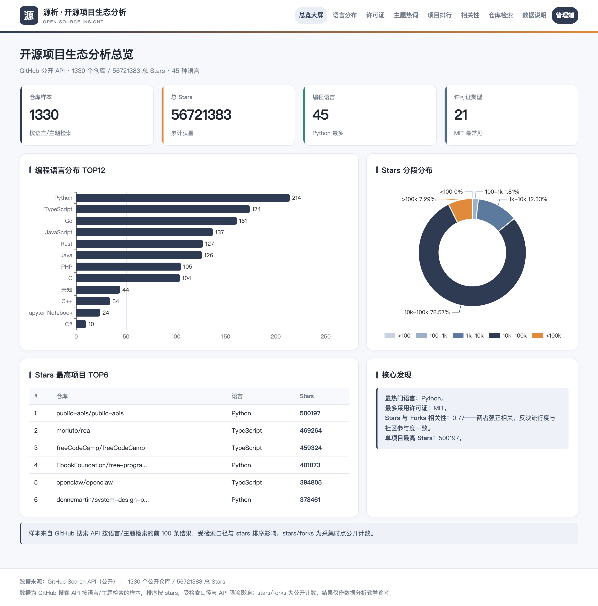
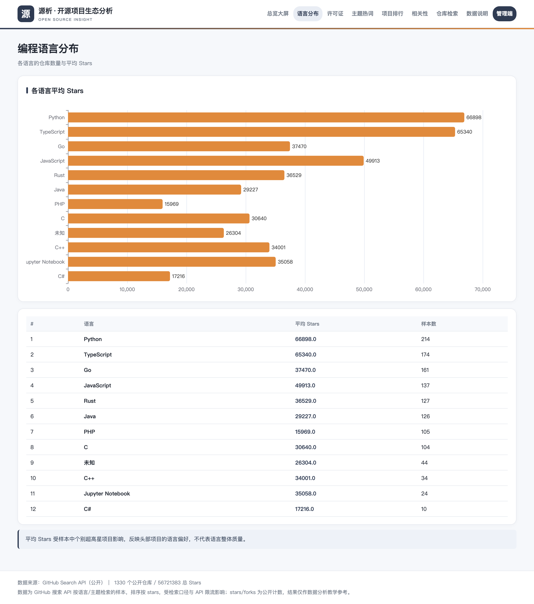
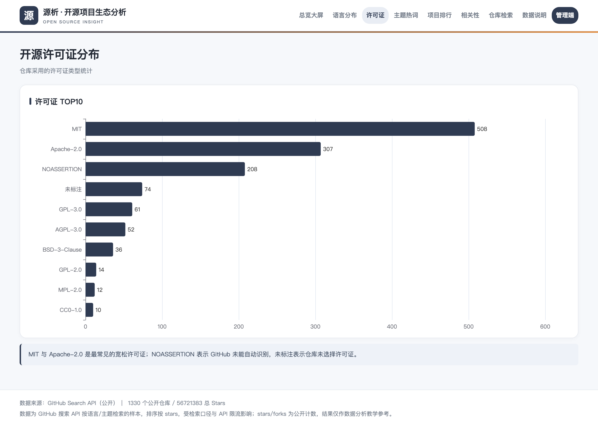
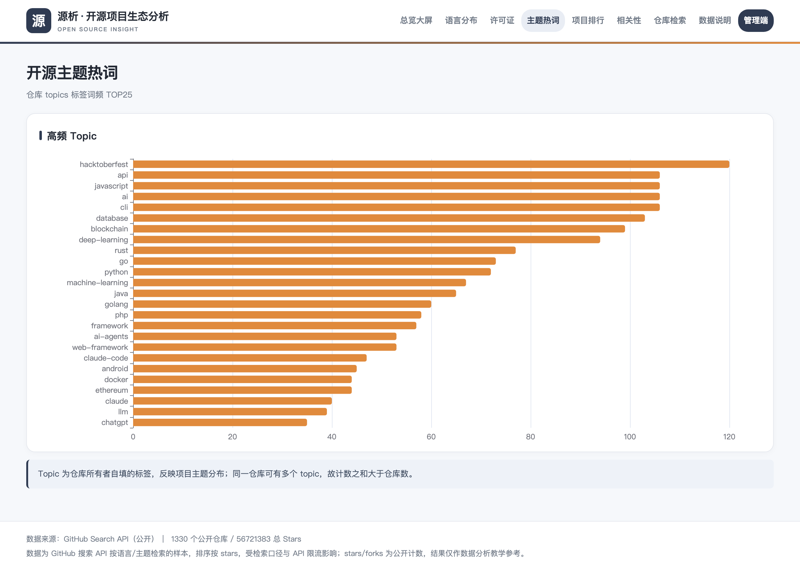
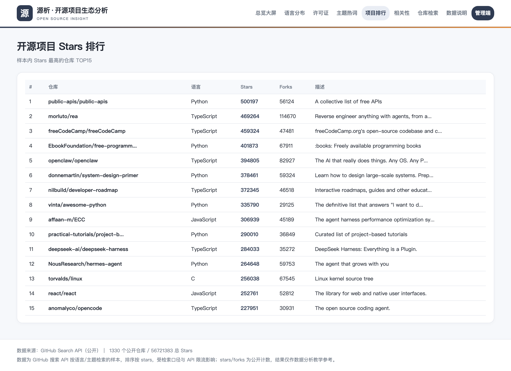
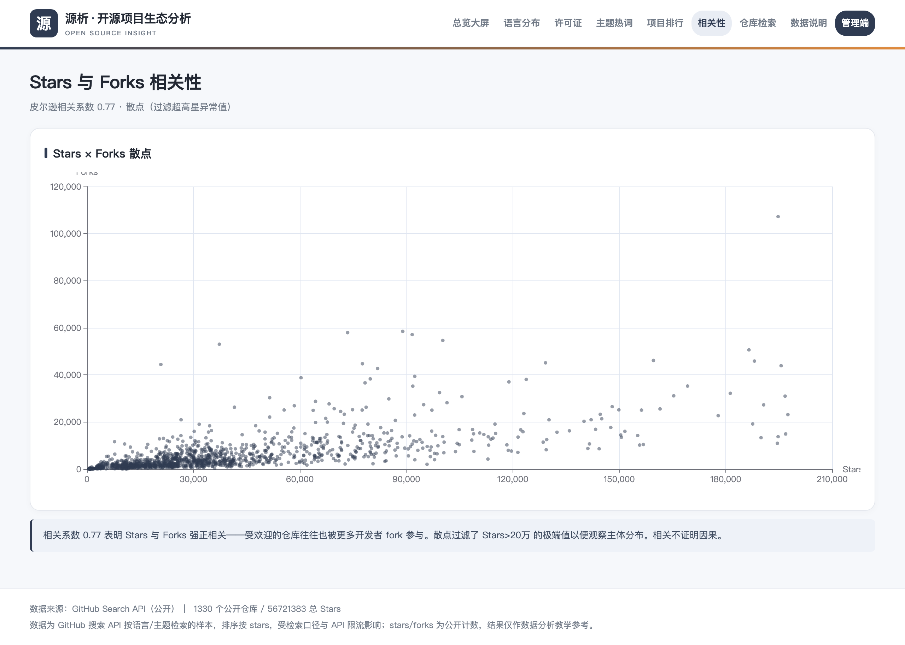

# 051 基于GitHub公开数据的开源项目生态分析系统-设计展示

> **代码有偿获取 可接受定制 微信联系方式: csbysj2020 或 ACE2487，备注(BS)**

> **完整源码与全套文档 · 在线自助获取 >>> [https://mbd.pub/o/bread/YZaWmJduZQ==](https://mbd.pub/o/bread/YZaWmJduZQ==)**

> **成品页（功能介绍 / 更多选题）>>> [https://bishe.suilang.net/products/opensource-insight](https://bishe.suilang.net/products/opensource-insight)**

> 

> 

## 视频

> **点击查看 >>> [https://www.bilibili.com/video/BV1xqs86dEuY/](https://www.bilibili.com/video/BV1xqs86dEuY/)**

## 项目简介

真实采集 GitHub Search API 公开数据，1330 个仓库、56721383 总 Stars、45 种语言、3434 种主题标签。多维统计语言分布、许可证分布、主题热词、Stars 排行与 Stars-Forks 相关性（r=0.77）；Python 语言项目最多、MIT 许可证最常见。8 个页面 ECharts 本地内置离线可用。搜索结果仅前100条的样本偏差与相关不等于因果如实标注，只做数据分析教学参考。

GitHub 公开 API 为研究开源生态提供了丰富元数据。

本项目设计并实现了一套基于 GitHub 公开数据的开源项目生态分析系统：通过 GitHub Search API 按语言与主题检索采集 1330 个公开仓库（总 56721383 Stars），结构化清洗后抽取语言、许可证、主题标签、Stars/Forks/Issues 等字段；多维统计语言分布、许可证分布、主题热词、Stars 排行与 Stars-Forks 相关性（r=0.77），发现 Python 语言项目最多、MIT 许可证最常见。

系统实现总览大屏、语言分布、许可证、主题热词、项目排行、相关性、仓库检索与数据说明共 8 个页面，ECharts 本地内置、离线可用。

本仓库为**设计展示**：包含项目说明、技术架构、实验结果与运行截图；完整源码、任务书、开题报告、毕业论文与使用说明可通过上方链接自助获取，成品页可查看更多选题，也可联系微信咨询定制。

## 功能特性

1. 真实采集：GitHub Search API 公开免登录，1330 仓库 / 56721383 Stars / 45 语言

2. 限流应对：未认证约10请求/分钟，脚本间隔7秒+失败重试，可放 token 提配额

3. 语言分布：各语言仓库数与平均 Stars，Python 最多

4. 许可证分布：21 类许可证，MIT 最常见；NOASSERTION 原值保留

5. 主题热词：3434 种 topic 标签词频，看开源热门方向

6. 项目排行：Stars 最高项目 TOP15，public-apis 居首

7. 相关性：Stars 与 Forks 皮尔逊系数 0.77，强正相关

8. 数字单一来源：页面与论文读 data/stats.json，重跑三步即可同步

9. 诚实边界：每查询仅前100条的样本偏差、单时点计数、相关不等于因果均如实标注

## 技术架构

| 项目 | 说明 |
| --- | --- |
| 编程语言 | Python 3.8+ |
| Web 框架 | Django 4.2（默认 SQLite） |
| 统计计算 | NumPy + 标准库 |
| 前端 | Django 模板 + 本地 ECharts |
| 样本规模 | 1330 仓库 / 45 语言 / 3434 topic |
| 运行端口 | http://127.0.0.1:8051 |
| 演示账号 | admin / admin123456 |

## 目录结构

以下为完整交付版的结构（本仓库仅作设计展示）：

```
opensource-insight/
├── analytics/
│   ├── __init__.py
│   └── build.py
├── crawler/
│   ├── __init__.py
│   └── fetch_github.py
├── data/
│   ├── analysis/
│   │   ├── lang_stars.json
│   │   ├── languages.json
│   │   ├── licenses.json
│   │   ├── overview.json
│   │   ├── scatter.json
│   │   ├── star_dist.json
│   │   ├── top_repos.json
│   │   ├── topics.json
│   │   └── years.json
│   ├── processed/
│   │   └── repos.csv
│   ├── raw/
│   │   ├── gh_language__Rust.json
│   │   ├── gh_language_C++.json
│   │   ├── gh_language_Go.json
│   │   ├── gh_language_Java.json
│   │   ├── gh_language_JavaScript.json
│   │   ├── gh_language_PHP.json
│   │   ├── gh_language_Python.json
│   │   ├── gh_language_TypeScript.json
│   │   ├── gh_topic_api.json
│   │   ├── gh_topic_blockchain.json
│   │   ├── gh_topic_cli.json
│   │   ├── gh_topic_database.json
│   │   ├── gh_topic_deep-learning.json
│   │   ├── gh_topic_machine-learning.json
│   │   └── gh_topic_web-framework.json
│   └── stats.json
├── gitscope/
│   ├── __init__.py
│   ├── settings.py
│   ├── urls.py
│   └── wsgi.py
├── gitviz/
└── …
```

## 数据与实验结论

- 真实采集：GitHub Search API 公开免登录，1330 仓库 / 56721383 Stars / 45 语言
- 限流应对：未认证约10请求/分钟，脚本间隔7秒+失败重试，可放 token 提配额
- 许可证分布：21 类许可证，MIT 最常见；NOASSERTION 原值保留
- 主题热词：3434 种 topic 标签词频，看开源热门方向

## 交付内容

1. 完整源码（Django + 采集器 + 分析引擎 + 8 页面）
2. 真实数据（raw JSON + CSV + SQLite）
3. 一键启动脚本
4. 任务书与开题报告（Word）
5. 毕业论文（Word 七章制）
6. 二次开发说明（Word+md）
7. 6 张截图 + 封面 + 演示视频

## 常见问题

**数据是爬的吗？能更新吗？**

是。crawler/fetch_github.py 调 GitHub Search API 采集，重跑采集→分析→入库即可更新。

**数据全吗？**

每查询取 stars 前100条，样本偏向高星项目，不能代表 GitHub 全量，数据说明页有注明。

**NOASSERTION 是什么？**

GitHub 未能自动识别的许可证，统计时按原值保留。

**相关说明因果吗？**

不说明，散点与系数只揭示线性关联。

**能换 MySQL 吗？**

能。设 DB_ENGINE=mysql 及 DB_NAME/DB_USER/DB_PASSWORD 后 migrate 即可，默认 SQLite 免安装。

## 截图







